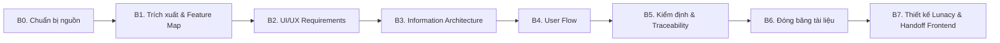

# QUY TRÌNH XÂY DỰNG BỘ TÀI LIỆU UI/UX — DEVRADAR

> Phạm vi: Quy trình 7 giai đoạn (B0–B7) để tạo ra bộ tài liệu **UI/UX Requirements**, **Information Architecture**, **User Flow**, và chuyển giao thiết kế đồ họa **Lunacy** (.free / .sketch) sang **Frontend React/Vite**.  
> Căn cứ nguồn: Source code 5 microservices trong `services/`, SRS v2.0 và SDD v2.0.  
> Thư mục: `docs/ui/QUY_TRINH_UIUX.md`

---

## 0. Tổng quan quy trình

### Nguyên tắc cốt lõi
1. **Code thực tế là nguồn chân lý số 1**: Khi có xung đột giữa tài liệu nghiệp vụ (SRS/SDD) và mã nguồn đang chạy (YARP Gateway, Docker port, Controller endpoint), luôn ưu tiên hành vi thực tế của code và gắn nhãn `[CONFLICT]`.
2. **Truy vết 2 chiều 100% (Bidirectional Traceability)**: Mọi màn hình (SCR), yêu cầu (UX), nút điều hướng (IA), và tiến trình (FLW) đều phải ánh xạ về mã Use Case (UC-01..UC-81) và endpoint API Gateway tương ứng.
3. **Phản hồi 4 trạng thái bắt buộc**: Mọi màn hình phải có đầy đủ trạng thái: Loading (Skeleton), Empty, Error (bắt mã 401, 403, 404, 429, 500), và Success.
4. **Kiểm duyệt AI và Real-time minh bạch**: Tích hợp chặt chẽ cơ chế kiểm duyệt tự động (AI Toxicity HuggingFace) và sự kiện realtime SignalR (`/hubs/community`, `/hubs/notifications`).

---

## 1. Giai đoạn B0 — Chuẩn bị nguồn & Môi trường
- **Mục tiêu**: Đóng băng phiên bản đầu vào, thiết lập thư mục làm việc và trích xuất dữ liệu từ các tệp SRS/SDD.
- **Thư mục làm việc**: `docs/ui/`, `docs/ui/working/`, `docs/ui/extracted/`, `docs/ui/validation/`.
- **Đầu ra**: Các file văn bản sạch trong `docs/ui/extracted/` (`SRS_full.txt`, `SDD_full.txt`).

---

## 2. Giai đoạn B1 — Trích xuất Feature Map & Đối soát nguồn
- **Mục tiêu**: Lập bảng ánh xạ trung gian giữa 81 Use Cases từ SRS với các API thực tế của 5 microservices và phát hiện các điểm sai lệch kỹ thuật.
- **Tài liệu sinh ra**: [docs/ui/working/feature_map.md](working/feature_map.md).
- **Tiêu chí hoàn thành (DoD)**:
  - 81/81 UC được phân loại đầy đủ theo 14 nhóm chức năng.
  - 100% dòng có endpoint API Gateway (:5000) hoặc gắn nhãn `[PLANNED]`.
  - Danh mục xung đột kỹ thuật (`[CONFLICT]`) được ghi nhận chi tiết (Cổng port, gộp AnalyticsService vào Crawler, JWT rotation).

---

## 3. Giai đoạn B2 — Xây dựng tài liệu UI/UX Requirements
- **Mục tiêu**: Chuyển đổi Feature Map thành đặc tả chi tiết màn hình và các tiêu chí kiểm thử nghiệm thu.
- **Tài liệu sinh ra**: [docs/ui/UIUX_Requirements.md](UIUX_Requirements.md).
- **Tiêu chí hoàn thành (DoD)**:
  - Định nghĩa đủ 5 Personas (Guest, Member, GitHub Dev, Moderator, Admin).
  - Screen Inventory bao phủ từ SCR-01 đến SCR-22 chia thành 6 cụm màn hình.
  - Tối thiểu 10 yêu cầu UX-xx chi tiết viết theo mẫu User Story + Given/When/Then.
  - Bảng ma trận phân quyền (RBAC) chi tiết cho từng màn hình.

---

## 4. Giai đoạn B3 — Thiết lập Kiến trúc thông tin (Information Architecture)
- **Mục tiêu**: Cấu trúc Sitemap phân cấp tối đa 3 cấp và mô hình điều hướng đa vai trò khớp với `Menus API` của `IdentityService`.
- **Tài liệu sinh ra**: [docs/ui/Information_Architecture.md](Information_Architecture.md).
- **Tiêu chí hoàn thành (DoD)**:
  - Sơ đồ Sitemap Mermaid không có node mồ côi.
  - Bảng danh mục Node IA-01..IA-18 chỉ rõ route URL đề xuất và nguồn API.
  - Quy chuẩn Header, Sidebar và Mobile Bottom Bar.

---

## 5. Giai đoạn B4 — Thiết lập Luồng người dùng (User Flows)
- **Mục tiêu**: Vẽ biểu đồ luồng nghiệp vụ tương tác giữa người dùng, giao diện và backend, bao gồm đầy đủ các nhánh lỗi và luồng ngang.
- **Tài liệu sinh ra**: [docs/ui/User_Flow.md](User_Flow.md).
- **Tiêu chí hoàn thành (DoD)**:
  - 14 luồng FLW-01 đến FLW-14 khớp 14 tiến trình cốt lõi trong SRS/SDD.
  - 4 luồng ngang kỹ thuật: Refresh token 1-lần-dùng (401), Giới hạn tần suất gọi (429), Kiểm duyệt tự động AI độc hại (Toxicity), Phục hồi kết nối SignalR.

---

## 6. Giai đoạn B5 — Kiểm định & Traceability
- **Mục tiêu**: Rà soát tính nhất quán giữa các tài liệu, đối chiếu chéo 2 chiều (Bidirectional Traceability) và xác nhận không có lỗ hổng kiến trúc.
- **Tài liệu sinh ra**: `docs/ui/validation/uiux_review_report.md`.
- **Tiêu chí hoàn thành (DoD)**:
  - 0 lỗi Blocker, 0 lỗi Major.
  - Toàn bộ 81 UC đều có màn hình và luồng tương ứng.

---

## 7. Giai đoạn B6 — Đóng băng tài liệu & Sẵn sàng bàn giao
- **Mục tiêu**: Cập nhật phiên bản 1.0, ghi nhận ngày ban hành và chuẩn bị bộ tài liệu bàn giao cho đội ngũ thiết kế đồ họa và lập trình Frontend.

---

## 8. Giai đoạn B7 — Thiết kế đồ họa trên Lunacy & Handoff Frontend
- **Mục tiêu**: Hiện thực hóa các yêu cầu thành file thiết kế vector trên **Lunacy** (.free / .sketch) và bàn giao thông số CSS/Component cho **React/Vite**.
- **Tài liệu hướng dẫn**: [docs/ui/QUY_TRINH_THIET_KE_LUNACY.md](QUY_TRINH_THIET_KE_LUNACY.md).
- **Các bước thực hiện**:
  1. Xây dựng Design System (Colors, Typography Inter, Buttons, Cards, Radar Widget).
  2. Dựng các Artboard chuẩn `1440x1024` theo Screen Inventory (SCR-01 đến SCR-22).
  3. Vẽ Wireframe và Hi-Fi Mockup cho từng màn hình kèm các trạng thái Loading/Empty/Error/Success.
  4. Đóng gói file `.free` (hoặc `.sketch`) để lưu trữ và cộng tác.
  5. Xuất mã CSS/Tailwind và vector SVG để lập trình viên Frontend ráp vào thư mục `frontend/`.
